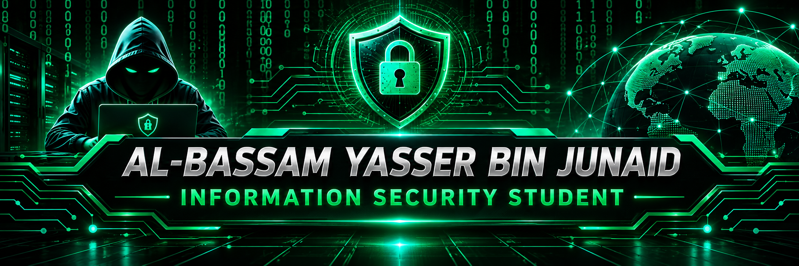

<!-- ================= CYBERSECURITY HEADER ================= -->

  

<!-- ================= TYPING TEXT ================= -->

  

<!-- ================= SOCIAL LINKS ================= -->

  

---

<!-- ================= ABOUT ME ================= -->

## 👨‍💻 About Me

Hello! I'm **Al-Bassam Yasser Bin Junaid**.

- 🎓 Information Security Student.
- 🔐 Passionate about Cybersecurity and Information Security.
- 🌐 Interested in Network Security and Ethical Hacking.
- 💻 Programming with Python and C#.
- 🐧 Exploring Linux and Cybersecurity Tools.
- 🔎 Learning about vulnerabilities and digital protection.
- 🚀 Working towards becoming a Cybersecurity Specialist.

---

<!-- ================= SKILLS ================= -->

## 💻 Programming Languages & Technologies

  

---

<!-- ================= SECURITY TOOLS ================= -->

## 🔐 Cybersecurity Tools

  
  
  

---

<!-- ================= LEARNING ================= -->

## 🎯 Currently Learning

- 🔍 Network Scanning & Enumeration
- 🛡️ Network Security
- 🐧 Linux Administration
- 🔐 Ethical Hacking Fundamentals
- 🌐 Web Application Security
- 🧪 Penetration Testing Fundamentals

---

<!-- ================= GITHUB STATS ================= -->

## 📊 GitHub Statistics

  

  

  

---

<!-- ================= CONTRIBUTIONS ================= -->

## 📈 Contribution Activity

  

---

<!-- ================= QUOTE ================= -->

## 💡 Cybersecurity Quote

  <i>"Security is not a product, but a process."</i>

---

<!-- ================= PROFILE VIEWS ================= -->

  

---

<!-- ================= FOOTER ================= -->

  <b>⚡ LEARN • EXPLORE • PROTECT • REPEAT ⚡</b>

  

